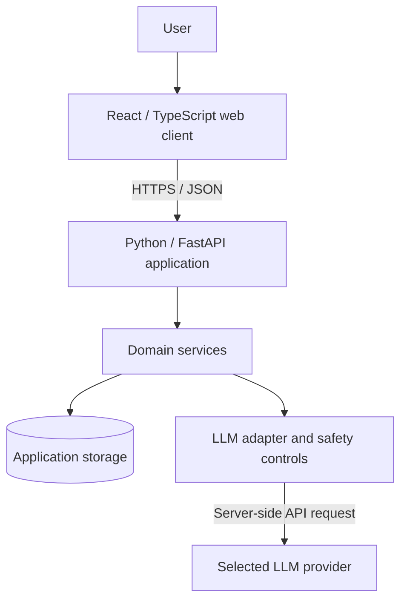

# LifeOS — Proposed Architecture

> **Status:** Planning only. Subject to change after technical spikes and user research. This document does not describe an implemented system.

## 1. Architectural goals

Build a small, comprehensible, testable personal-development web application. Prioritize user autonomy, safe handling of personal reflections, portability between language-model providers, and clear separation between deterministic application behavior and probabilistic AI responses.

Avoid premature microservices, complex multi-agent orchestration, vector databases, or unnecessary third-party integrations.

## 2. System context



All model credentials remain server-side. Use synthetic test personas and avoid disclosing real users' private reflections in shared logs, prompts, demos, or development transcripts.

## 3. Proposed technology stack

| Layer | Candidate | Rationale |
|---|---|---|
| UI | React + TypeScript | Modular forms, guided experiences, and review screens |
| Backend | Python + FastAPI | Explicit contracts, validation, testable domain logic |
| Data | PostgreSQL (later stage) | Relational data, access control, migrations |
| Prototype persistence | Minimal local test storage | Avoid infrastructure before persistence requirements are validated |
| LLM | Provider-independent interface | Swap Claude/OpenAI/other providers without rewriting domain logic |
| API contracts | Pydantic / OpenAPI | Schema validation and generated documentation |
| Tests | pytest; frontend unit and end-to-end tests | Prevent regressions in critical user journeys |

These are proposals, not commitments. Select versions and libraries during implementation.

## 4. Logical modules

- **Life Compass:** domain reflections, optional subjective ratings, user-edited summaries.
- **Life Strategy:** user-selected priorities, goals, and manageable next actions.
- **Daily Companion (future):** optional daily check-in and reflection.
- **Life Review:** revisit actions, revise plans, and reflect without performance scoring.
- **Personal Memory (later):** controlled persistence of explicitly approved information.
- **AI Guidance:** structured prompts, grounded summaries, uncertainty handling, and output validation.
- **User Data Controls:** consent choices and inspect/edit/delete/export capabilities before supporting real personal data.

## 5. Data boundaries and proposed entities

Possible entities: `User`, `LifeDomainReflection`, `ValueStatement`, `Priority`, `ActionStep`, `Review`, and `MemoryItem`.

Prefer structured, purpose-limited records over permanently storing all raw chat transcripts. Every persisted item should have a clear owner, purpose, creation time, retention/deletion policy, and access-control path.

**MVP note:** Authentication and durable user storage may be deferred when testing with synthetic profiles in a local environment. Do not invite real users to enter private information until the privacy implementation gate in `MVP_SCOPE.md` is satisfied.

## 6. Illustrative API contracts (not implemented)

- `POST /api/v1/compass/reflections` — validate and summarize a fictional/test reflection.
- `POST /api/v1/priorities` — record a user-selected priority.
- `POST /api/v1/guidance/suggest-action` — suggest an optional next step.
- `POST /api/v1/reviews` — record a review and possible revision.

These endpoints are design candidates. Use schema validation and avoid inventing endpoints until a user flow requires them.

## 7. AI integration

Separate orchestration from the model SDK:

```text
Application flow
  -> input validation / privacy filtering
  -> prompt builder with minimum necessary context
  -> LLMProvider interface
  -> structured output parsing / validation
  -> user-visible suggestion (editable, rejectable)
```

- Treat model output as untrusted; never grant it arbitrary database, filesystem, or network actions.
- Keep system and policy instructions outside user-controlled content.
- Limit sensitive data sent to third-party providers; explain any provider processing before real usage.
- Provide graceful failure if the LLM is unreachable.
- Do not infer diagnoses or claim therapeutic efficacy.
- Escalate apparent urgent safety concerns toward appropriate human/emergency support; do not portray the AI as a crisis responder.

## 8. Privacy and security requirements

Before real-user deployment:
- Document data flows, lawful basis and notices where applicable, consent choices, processor arrangements, and retention periods.
- Implement authentication (if accounts exist), authorization per user, secure transport, secret management, and audit controls proportionate to risk.
- Enable users to review, correct, export, and delete saved information; make limitations and provider-side retention clear.
- Minimize and redact telemetry, and never log secrets or raw personal conversations by default.
- Run threat modeling and security tests covering prompt injection, broken access control, exposed credentials, and sensitive-data leakage.
- Assess GDPR obligations and whether a DPIA is required before handling real sensitive information.

## 9. Deployment and environments

First milestone: local-only development with fictional data. Later, use separate development and production configurations, repeatable migrations, environment-based secrets, secure CI checks, backups, and documented recovery procedures.

Never commit `.env`, API keys, private exports, database dumps, or identifying test data.

## 10. Testing and quality gates

- Unit-test deterministic domain logic and validation.
- Mock LLM responses in automated tests; maintain reproducible fixtures.
- Test the full Compass -> Priority -> Suggested Action -> Review journey.
- Test refusal/correction of AI suggestions and provider outages.
- Add privacy, authorization, and security tests before any real-user rollout.
- Record architecture decisions as short ADRs only when important decisions are made.

## 11. Open decisions

1. What is the minimum viable persistence model?
2. Is account creation necessary for MVP testing?
3. What context can the model see, and for how long?
4. Which provider policies permit development/evaluation transcript sharing?
5. How will usability and user agency be assessed without unsupported wellbeing claims?

See [Product Vision](PRODUCT_VISION.md) and [MVP Scope](MVP_SCOPE.md).
